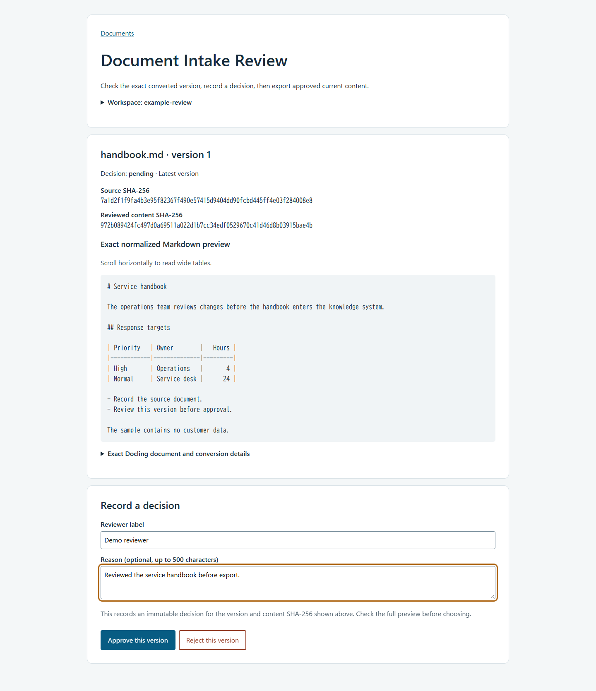

# Document Intake Review

Review local documents in your browser before they enter a knowledge system.
Upload Markdown or DoclingDocument JSON, inspect the exact converted version,
record an approval or rejection, and export approved current content as JSONL.
If a source changes, its previous approval cannot authorize the new content.

## Demo



The installed demo command creates a new workspace with a synthetic handbook
in **pending** status. Open it in your browser and make the review decision
yourself. The sample is included in the app wheel; a checkout is not needed
after installation.

```sh
intake-review demo --workspace ./demo-workspace
intake-review serve --workspace ./demo-workspace
```

Open the printed URL, normally **http://127.0.0.1:8765/**. Keep the terminal
open while using the browser. Stop with Ctrl+C and use the same workspace to
resume. To use another local port, add `--port 8766`.

For a captured CLI example with actual gate errors and exported records, open
the [offline demo result](docs/demo-result.html).

## Install from this checkout

Use **Python 3.12**. The source installer creates an isolated environment,
installs locked dependencies, builds three local wheels, and installs those
wheels. Initial setup downloads the locked dependencies; document operations
remain local.

```powershell
# Windows PowerShell
py -3.12 tools/install_source.py
.v\Scripts\intake-review demo --workspace .\demo-workspace
.v\Scripts\intake-review serve --workspace .\demo-workspace
```

```sh
# Linux
python3.12 tools/install_source.py
.v/bin/intake-review demo --workspace ./demo-workspace
.v/bin/intake-review serve --workspace ./demo-workspace
```

Use a fresh environment and demo workspace. The installer keeps its command
receipt and wheel hashes in `.source-build/`. Follow this source installer
rather than installing the upstream packages from a registry: the runtime
verifier requires the included, pinned source wheels.

## Use your documents

1. Start `intake-review serve --workspace PATH` with your chosen local workspace.
2. Choose **Add a document**, select a `.md` or `.json` file, and upload it.
   Uploads are limited to 1 MiB and never overwrite an existing source.
3. Read the exact normalized Markdown and, when needed, expand the Docling
   document details. Enter a reviewer label and optional reason. Choose
   **Approve this version** or **Reject this version**.
4. Export the approved document, or export all approved current documents
   from the Documents page. Choose a new `.jsonl` filename and download it.

Decisions are immutable. To review changed content, edit the workspace's file
under `sources/` and choose **Re-intake source**. New content creates a pending
version. Unchanged content reuses its existing version and decision.

## Boundaries and development

The browser server binds only to `127.0.0.1`. It is for a single local user;
reviewer labels are not authenticated identities. Document text is displayed
as escaped text. Markdown resource fetching is disabled. PDF/OCR, model calls,
cloud services and remote hosting are outside this tool's supported scope.

See [local operation and security boundaries](docs/local-use.md),
[architecture](docs/architecture.md), and
[source identity and preserved licenses](docs/source-composition.md).
The browser and CLI use the same `Store` approval and export rules.

```sh
.v/bin/python tools/verify_source.py --installed-only --label local-check --reference-dir .
```

On Windows, use `.v\Scripts\python` in that command. The verification command
checks installed source identity, the review and HTTP regression suite, scoped
lint, and the installed CLI demo. The CI workflow configures the same source
installation and installed-app checks on Windows and Linux; a configuration
change is not evidence that the remote workflow has run.

The app is [MIT-licensed](LICENSE). The copied Docling and Docling Core packages
retain their [original](components/docling-slim/LICENSE)
[licenses](components/docling-core/LICENSE). See [security reporting](SECURITY.md).
