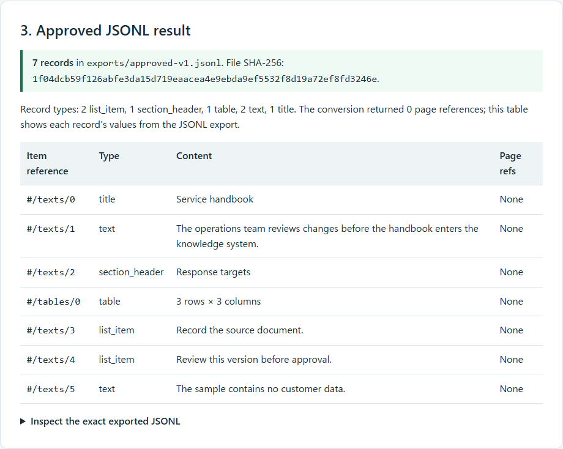

# Document Intake Review

Document Intake Review turns a local Markdown handbook or DoclingDocument JSON
file into JSONL only after a reviewer checks the exact converted version and
approves its content hash. If the source changes, an old approval cannot be
used for export.



Start with the [saved offline demo result](docs/demo-result.html). It shows the
synthetic input, what the reviewer sees, each blocked and approved transition,
and the actual exported records. For the implementation path, see
[entry points and data flow](docs/architecture.md).

## What the demo actually does

The checked-in [fixture](fixtures/intake.md) is a customer-free service
handbook. The demo copies it into a new workspace, then changes only that copy.
Its response-target table contains `High | Operations | 4` and
`Normal | Service desk | 24`; after exporting version 1, the demo changes the
first target from 4 to 6.

The recorded run used Python 3.12.14 and the installed `intake-review` CLI.
It ran 12 CLI commands and observed this sequence:

| Input or action | Observed result |
| --- | --- |
| Intake the unchanged fixture | Version 1, pending; repeated intake reused version 1. |
| Export before review approval | Blocked with exit code 2. |
| Approve version 1 against its content SHA-256 | Approval recorded for that exact version. |
| Export the approved version | `approved-v1.jsonl`, 7 records; the saved result shows this run's exact SHA-256. |
| Change `Hours` from 4 to 6 and try the old export | Blocked with exit code 2 because the source bytes changed. |
| Intake the changed fixture | Version 2, pending; an approval against version 1 and export of version 2 were both blocked with exit code 2. |

The saved HTML contains the exact fixture, normalized review text, gate errors,
and JSONL output from that run. Its “Demo reviewer” label is illustrative,
not an authenticated identity. This is a local review gate, not a hosted
workflow or an external-index uploader.

The export hash is run-specific because exported records retain the decision
timestamp. Compare a run with the hash in that run's receipt.

## Run it locally

Use Python 3.12. The source installer creates `.v`, installs locked runtime and
test dependencies, builds the local adapter and its included source packages,
and records its commands and hashes under `.source-build/`.

```sh
python tools/install_source.py
```

Create a new output directory for each demo run because the demo refuses to
overwrite an existing workspace, receipt, or HTML result.

```powershell
# Windows
New-Item -ItemType Directory -Force .verification\demo-run | Out-Null
.v\Scripts\python tools/demo.py `
  --workspace .verification\demo-run\workspace `
  --receipt .verification\demo-run\receipt.json `
  --html .verification\demo-run\result.html
.v\Scripts\python -m pytest -q
```

```sh
# Linux
mkdir -p .verification/demo-run
.v/bin/python tools/demo.py \
  --workspace .verification/demo-run/workspace \
  --receipt .verification/demo-run/receipt.json \
  --html .verification/demo-run/result.html
.v/bin/python -m pytest -q
```

The HTML file is standalone and works offline. The JSON receipt preserves each
CLI command, output, exit code, exported-file hash, and the saved HTML hash.
Package downloads are needed for the initial installation; conversion and
review use local files. Do not substitute `pip install .`: the installer
builds the included packages and installs their wheels without package-index
fallback.

The CI workflow is configured to run this demo with the installed `.v` Python
after source installation and verification. That CI step has not run for this
change yet.

## Find the implementation

| If you want to… | Start here |
| --- | --- |
| Run the end-to-end example and save its receipt and HTML | [`tools/demo.py`](tools/demo.py) |
| Inspect the exact CLI contract | [`intake_review.py`](intake_review.py), `main()` |
| Follow Markdown/JSON conversion | [`intake_review.py`](intake_review.py), `convert()` |
| Follow versioning, review, decisions, and export checks | [`intake_review.py`](intake_review.py), `Store` |
| See the data boundary and decision flow | [Architecture](docs/architecture.md) |
| Run the review and source-identity tests | [`tests/`](tests/) |
| Read the reference and design checks | [`DESIGN.md`](DESIGN.md) |

Markdown and validated DoclingDocument JSON use the same review and export
gate. The converter disables local, remote, and image fetching. The demo uses
only the checked-in synthetic Markdown fixture. PDF/OCR, model weights,
authenticated reviewer identities, servers, retention services, and external
index upload are outside this implementation.

The adapter is MIT-licensed ([LICENSE](LICENSE)). The included packages retain
their license files: [Docling](components/docling-slim/LICENSE) and
[Docling Core](components/docling-core/LICENSE).
